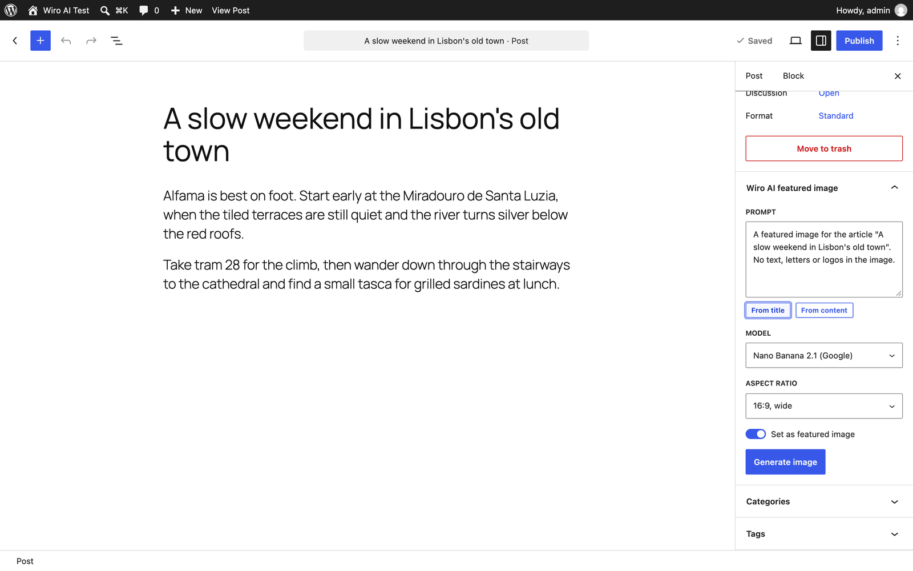
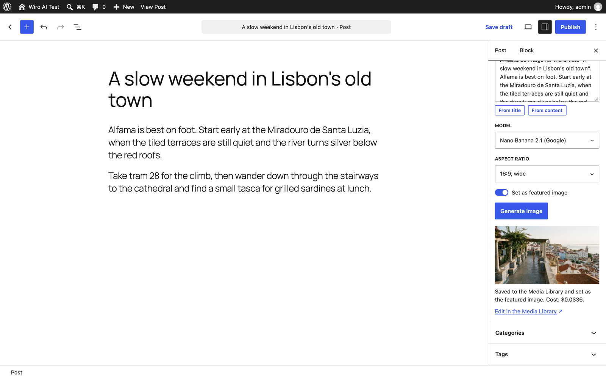
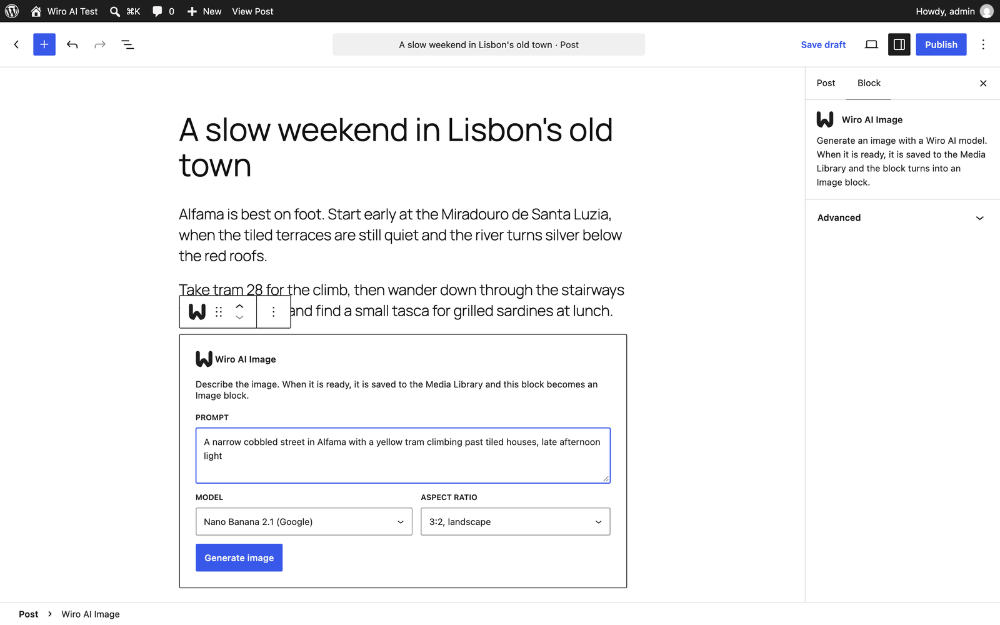
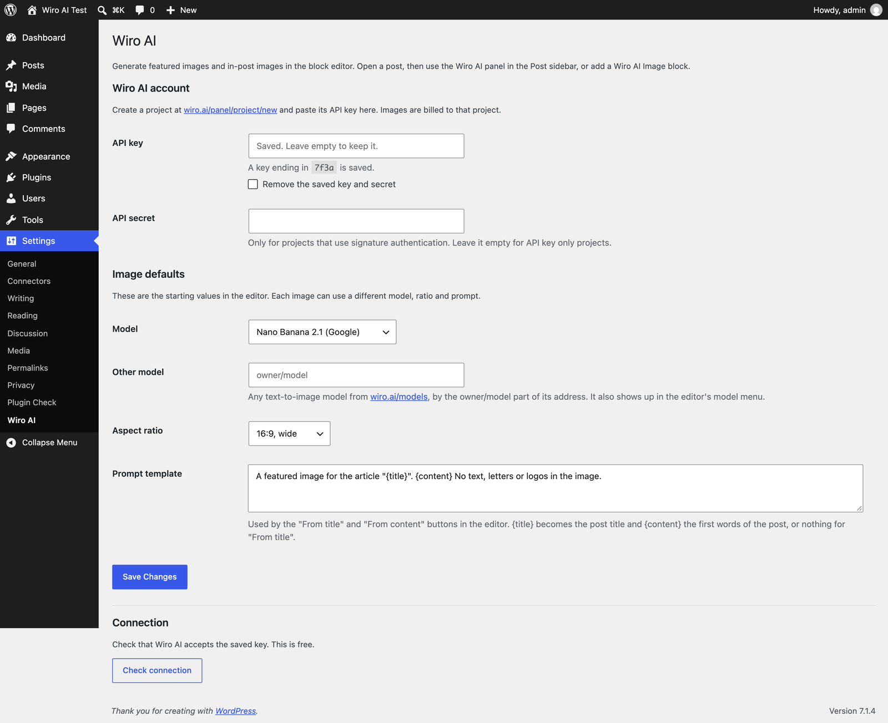

<div align="center">


# Wiro AI for WordPress

Generate featured images and in-post images in the WordPress block editor with Wiro AI: Nano Banana, GPT Image 2, Seedream, FLUX.2 or any other text-to-image model from a catalog of 1,000+ models.

[](https://github.com/wiroai/Wiro-WordPress/actions/workflows/ci.yml) [](./readme.txt) [](./readme.txt) [](./readme.txt) [](./LICENSE)

[Website](https://wiro.ai) · [Models](https://wiro.ai/models) · [Docs](https://wiro.ai/docs) · [Dashboard](https://wiro.ai/panel)


</div>

The plugin adds a **Wiro AI featured image** panel to the Post sidebar and a **Wiro AI Image** block. Write a prompt, or build one from the post title or content, pick a model, and the finished image is saved to the Media Library and set as the featured image. The editor only talks to your own site; WordPress calls the [Wiro AI API](https://wiro.ai/docs/run-a-model) with your project's key, so the key never reaches the browser.



## Features

- **Featured images from your post.** "From title" and "From content" turn the post title, or its first 60 words, into a prompt you can edit. One click generates the image, saves it to the Media Library and sets it as the featured image.
- **Wiro AI Image block.** Describe an image anywhere in a post. When it is ready, the block replaces itself with a core Image block, so the post keeps working without the plugin.
- **Eight models in the menu, plus any other one.** Add any text-to-image model from [wiro.ai/models](https://wiro.ai/models) by its slug on the settings page.
- **Aspect ratios from 16:9 to 9:16.** Each model gets the ratio in the form it expects: its ratio menu, the closest option it supports, or a width and height of about one megapixel.
- **Tidy Media Library entries.** The file is named after the post title, the alt text is filled in, the prompt goes into the description, and the image is attached to the post.
- **Cost on screen.** The panel shows what each image cost once it is ready.





## Install

1. Download `wiro-ai.zip` from the [latest release](https://github.com/wiroai/Wiro-WordPress/releases/latest).
2. In WordPress, go to **Plugins → Add New Plugin → Upload Plugin**, choose the zip and activate **Wiro AI**.

To build the zip yourself, clone the repository and run `bin/build-zip.sh`. It writes `build/wiro-ai.zip` with only the files the plugin needs.

The plugin needs WordPress 6.6 or newer, PHP 7.4 or newer and the block editor. It is tested up to WordPress 7.1.

## Set your API key

Create a project at [wiro.ai/panel/project/new](https://wiro.ai/panel/project/new) and copy its API key. If you pick signature authentication, copy the API secret too. Then open **Settings → Wiro AI**, paste the key (and secret), save, and click **Check connection**. The check is free.

The settings page never prints the saved key back into the form: it shows the last four characters, and an empty field keeps the saved value. To keep the key out of the database, define it in `wp-config.php` instead:

```php
define( 'WIRO_AI_API_KEY', 'your-api-key' );
define( 'WIRO_AI_API_SECRET', 'your-api-secret' ); // Only for signature-based projects.
```



## Models

| Model | Slug | Notes |
| --- | --- | --- |
| Nano Banana 2.1 | [`google/nano-banana-2-1`](https://wiro.ai/models/google/nano-banana-2-1) | Default model |
| GPT Image 2 | [`openai/gpt-image-2`](https://wiro.ai/models/openai/gpt-image-2) | Sent with `quality: medium` |
| Seedream 5 Pro | [`bytedance/seedream-v5-pro`](https://wiro.ai/models/bytedance/seedream-v5-pro) | |
| FLUX.2 Pro | [`black-forest-labs/flux-2-pro`](https://wiro.ai/models/black-forest-labs/flux-2-pro) | Ratio sent as width and height |
| Nano Banana Pro | [`google/nano-banana-pro`](https://wiro.ai/models/google/nano-banana-pro) | |
| Grok Imagine Image 2 | [`xai/grok-imagine-image-v2`](https://wiro.ai/models/xai/grok-imagine-image-v2) | |
| Qwen Image 3.0 | [`alibaba/qwen-image-3-0`](https://wiro.ai/models/alibaba/qwen-image-3-0) | |
| P-Image | [`pruna/p-image`](https://wiro.ai/models/pruna/p-image) | Fast, low cost |

**Other model** on the settings page takes any slug, or the model page URL, such as `https://wiro.ai/models/bytedance/seedream-v5-lite`. Required settings that the plugin does not set, such as a resolution, get the model's own default, read from [Tool/Detail](https://wiro.ai/docs/models) and cached for 12 hours. Each image is billed to your Wiro AI project at the price on the model's page.

## How it works

1. The editor sends the prompt, model, ratio and post ID to `POST /wp-json/wiro-ai/v1/tasks`.
2. WordPress builds the model's parameters and starts a task with `POST https://api.wiro.ai/v1/Run/{owner}/{model}`. The Wiro AI task token stays on the server; the editor gets a random ID that only works for the user who started the task.
3. The editor polls `GET /wp-json/wiro-ai/v1/tasks/{id}` every few seconds. WordPress reads the task with `Task/Detail` until it reaches `task_postprocess_end`, then checks that `pexit` is `"0"` ([Tasks](https://wiro.ai/docs/tasks)).
4. WordPress downloads the image, only from an HTTPS `*.wiro.ai` host, adds it to the Media Library with `media_handle_sideload()`, and returns the attachment. The panel sets it as the featured image; the block turns into a core Image block.

Starting an image needs the `upload_files` capability (Authors and above) and permission to edit the post. Requests use the [`x-api-key` header](https://wiro.ai/docs/authentication), plus `x-nonce` and `x-signature` for signature-based projects.

## Hooks

```php
// Only administrators can spend from the site's Wiro AI project.
add_filter( 'wiro_ai_generate_capability', fn () => 'manage_options' );

// Change the models in the menu. Keys are owner/model slugs; "params" are sent with every request.
add_filter( 'wiro_ai_models', function ( $models ) {
	unset( $models['google/nano-banana-pro'] );
	$models['bytedance/seedream-v5-lite'] = array( 'label' => 'Seedream 5 Lite (ByteDance)' );
	return $models;
} );

// Adjust the parameters of one request.
add_filter( 'wiro_ai_run_params', function ( $params, $slug, $context ) {
	if ( 'google/nano-banana-2-1' === $slug ) {
		$params['resolution'] = '2K';
	}
	return $params;
}, 10, 3 );
```

## Privacy

The plugin sends nothing until a key is saved. When someone clicks **Generate image**, it sends the prompt, model and image settings with the API key to `api.wiro.ai`, checks the task every few seconds, and downloads the result from Wiro AI's file servers. It sends no other post content, user data or site address. See the [Wiro AI terms of service](https://wiro.ai/agreement/terms-of-service) and [privacy policy](https://wiro.ai/agreement/privacy-policy).

## Development

The plugin has no build step: the editor scripts are plain JavaScript on top of the `wp.*` packages.

```bash
composer install            # PHPCS with WordPress Coding Standards, PHPCompatibility and PHPUnit
vendor/bin/phpcs            # lint PHP
vendor/bin/phpunit          # unit tests for request building, slugs, outputs and URL checks
npm install && npm run lint:js
bin/build-zip.sh            # build/wiro-ai.zip
```

CI also runs [Plugin Check](https://wordpress.org/plugins/plugin-check/) on the built plugin. To try it in a local site, mount `build/wiro-ai` into `wp-content/plugins/wiro-ai`.

## More from Wiro AI

| Repository | What it is |
| --- | --- |
| [Wiro-MCP](https://github.com/wiroai/Wiro-MCP) | Official MCP server for Wiro AI, [`@wiro-ai/wiro-mcp` on npm](https://www.npmjs.com/package/@wiro-ai/wiro-mcp) |
| [Wiro-Plugin](https://github.com/wiroai/Wiro-Plugin) | Wiro AI plugin for Cursor, Claude Code, Gemini CLI and Devin |
| [Wiro-LLM](https://github.com/wiroai/Wiro-LLM) | Wiro AI provider for the Vercel AI SDK and LLM gateway examples, [`@wiro-ai/wiro-llm` on npm](https://www.npmjs.com/package/@wiro-ai/wiro-llm) |
| [Wiro-WordPress](https://github.com/wiroai/Wiro-WordPress) | Wiro AI plugin for WordPress: featured images and an image block (this repository) |
| [Wiro-ComfyUI](https://github.com/wiroai/Wiro-ComfyUI) | Wiro AI nodes for ComfyUI |
| [Wiro-Dify-Plugin](https://github.com/wiroai/Wiro-Dify-Plugin) | Wiro AI plugins for Dify: the LLM gateway as a model provider, plus image, video, speech and music tools |
| [Wiro-Zed](https://github.com/wiroai/Wiro-Zed) | Wiro AI MCP server for the Zed editor |
| [Wiro-Raycast](https://github.com/wiroai/Wiro-Raycast) | Wiro AI extension for Raycast |
| [Wiro-Action](https://github.com/wiroai/Wiro-Action) | GitHub Action for Wiro AI |
| [Wiro-Hermes](https://github.com/wiroai/Wiro-Hermes) | Wiro AI as a model provider for Hermes Agent |
| [Wiro-Next-Starter](https://github.com/wiroai/Wiro-Next-Starter) | Next.js starter for Wiro AI |
| [n8n-nodes-wiroai](https://github.com/wiroai/n8n-nodes-wiroai) | Wiro AI nodes for n8n, [`@wiro-ai/n8n-nodes-wiroai` on npm](https://www.npmjs.com/package/@wiro-ai/n8n-nodes-wiroai) |
| [Wiro-Chromium-Extension](https://github.com/wiroai/Wiro-Chromium-Extension) | Wiro AI extension for Chrome, Edge, Opera and Brave |
| [Wiro-Firefox-Extension](https://github.com/wiroai/Wiro-Firefox-Extension) | Wiro AI add-on for Firefox |
| [Wiro-Safari-Extension](https://github.com/wiroai/Wiro-Safari-Extension) | Wiro AI extension for Safari on the Mac |
| [Swift-QuickStart](https://github.com/wiroai/Swift-QuickStart) | WiroKit, the Wiro AI SDK for iOS |
| [Kotlin-QuickStart](https://github.com/wiroai/Kotlin-QuickStart) | WiroKit, the Wiro AI SDK for Android |
| [Dart-QuickStart](https://github.com/wiroai/Dart-QuickStart) | Wiro AI SDK for Dart and Flutter, [`wiro` on pub.dev](https://pub.dev/packages/wiro) |
| [ReactNative-QuickStart](https://github.com/wiroai/ReactNative-QuickStart) | Wiro AI SDK for React Native and Expo, [`@wiro-ai/wiro-react-native` on npm](https://www.npmjs.com/package/@wiro-ai/wiro-react-native) |
| [Swift-Realtime](https://github.com/wiroai/Swift-Realtime) | Realtime voice AI example for iOS |
| [Kotlin-Realtime](https://github.com/wiroai/Kotlin-Realtime) | Realtime voice AI example for Android |
| [Dart-Realtime](https://github.com/wiroai/Dart-Realtime) | Realtime voice AI example for Flutter |
| [ReactNative-Realtime](https://github.com/wiroai/ReactNative-Realtime) | Realtime voice AI example for React Native |
| [Wiro-Docs](https://github.com/wiroai/Wiro-Docs) | Source of the Wiro AI API docs |

[Website](https://wiro.ai) · [Models](https://wiro.ai/models) · [Docs](https://wiro.ai/docs) · [X](https://x.com/wiroai)

## License

GPL-2.0-or-later, see [LICENSE](./LICENSE).
