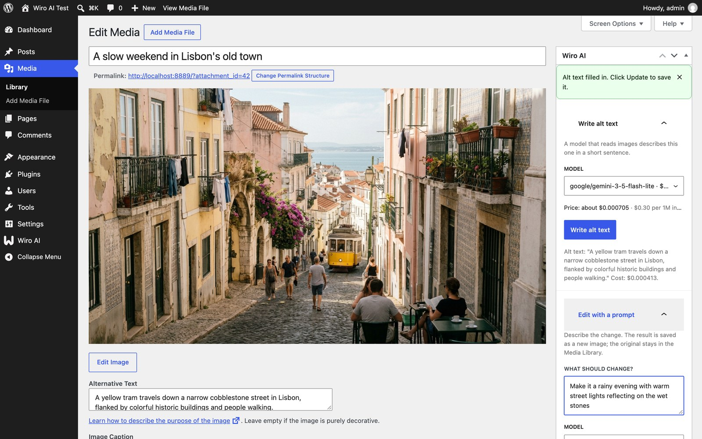
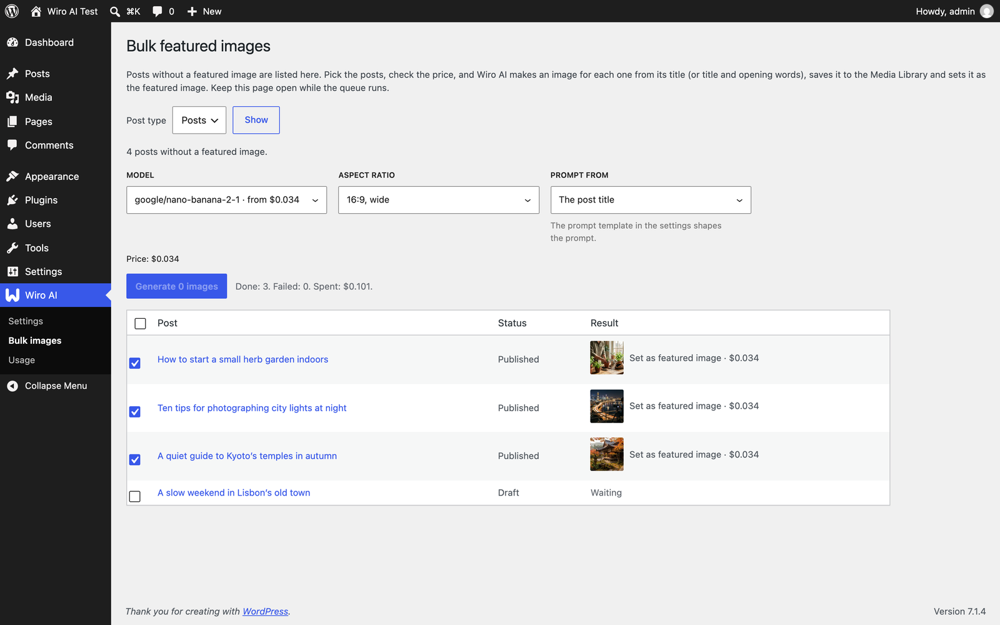
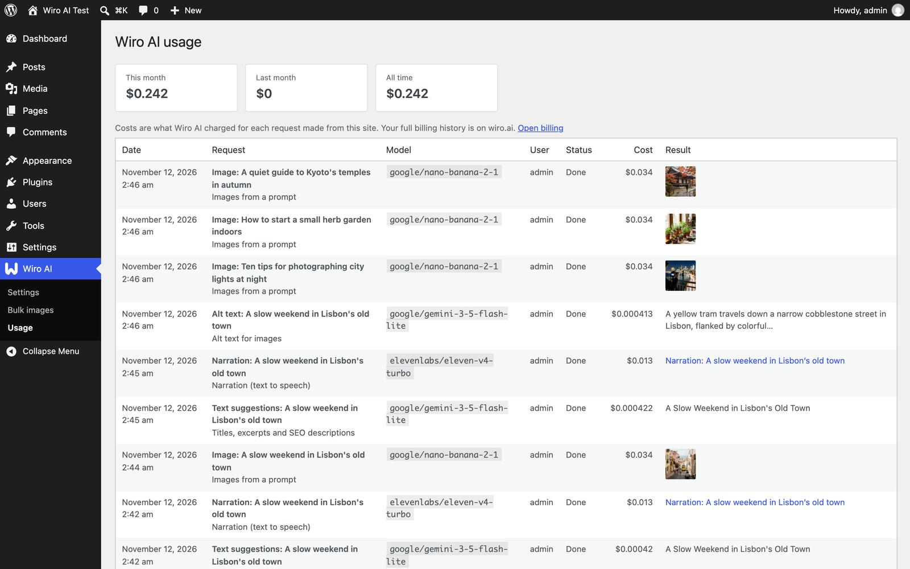
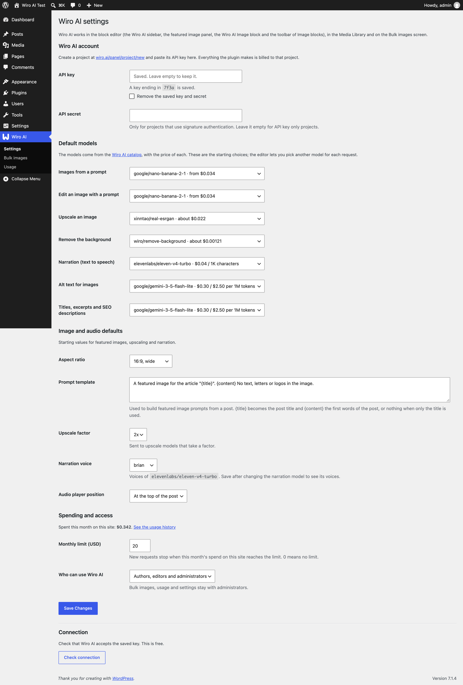

<div align="center">


# Wiro AI for WordPress

Featured images, image editing, upscaling, background removal, alt text, narration and SEO suggestions in WordPress, with models from the Wiro AI catalog of 1,000+.

[](https://github.com/wiroai/Wiro-WordPress/actions/workflows/ci.yml) [](./readme.txt) [](./readme.txt) [](./readme.txt) [](./LICENSE)

[Website](https://wiro.ai) · [Models](https://wiro.ai/models) · [Docs](https://wiro.ai/docs) · [Dashboard](https://wiro.ai/panel)


</div>

The plugin adds a Wiro AI sidebar to the block editor, a Wiro AI menu to every Image block, Wiro AI tools to images in the Media Library, and Bulk images and Usage screens to the admin. Each tool shows the price of the request before it runs, and every result is saved to the Media Library or the post. The editor only talks to your own site: WordPress calls the [Wiro AI API](https://wiro.ai/docs/run-a-model) and the [LLM gateway](https://wiro.ai/docs/completions-api) with your project's key, so the key never reaches the browser.


## Features

**Featured images**

- **From the post.** "From title" and "From content" turn the post title, or its first 60 words, into a prompt you can edit. One click makes the image, saves it to the Media Library and sets it as the featured image. The same tool sits in the Post sidebar.
- **Bulk featured images.** Wiro AI > Bulk images lists posts with no featured image. Pick the posts, check the total price, confirm, and a queue makes and sets the images, two at a time.
- **Wiro AI Image block.** Describe an image anywhere in a post. When it is ready, the block replaces itself with a core Image block, so the post keeps working without the plugin.

**Image tools**, in the W menu of any Image block and in the Wiro AI box on Media Library images:

- **Edit with a prompt**, for example "make it a rainy evening with warm street lights".
- **Upscale** to a larger, sharper copy, 2x or 4x.
- **Remove the background** for a transparent PNG.
- **Write alt text** with an LLM that reads images, in the site's language.

Edits are saved as new images next to the original, and the block change can be undone like any edit.

**Text and speech**

- **Titles, excerpt and SEO description.** An LLM reads the post and suggests three titles, an excerpt and a meta description of up to 155 characters. Apply a title or the excerpt with one click, or copy the description into an SEO plugin.
- **Narration.** A text-to-speech model reads the title and content (up to 10,000 characters) in the voice you pick. The MP3 goes to the Media Library and an Audio block is added to the top or the end of the post.

**Control**

- **Price before you run**, worked out from the model's price list and the request's settings.
- **Usage history** with the user, model, cost and result of every request, and the spend per month.
- **Monthly spending limit** for the site.
- **Access level:** authors and up, editors and up, or administrators only.
- **Key in wp-config.php** if you prefer it out of the database.








## Install

1. Download `wiro-ai.zip` from the [latest release](https://github.com/wiroai/Wiro-WordPress/releases/latest).
2. In WordPress, go to **Plugins → Add New Plugin → Upload Plugin**, choose the zip and activate **Wiro AI**.

To build the zip yourself, clone the repository and run `bin/build-zip.sh`. It writes `build/wiro-ai.zip` with only the files the plugin needs.

The plugin needs WordPress 6.6 or newer and PHP 7.4 or newer. It is tested up to WordPress 7.1. The editor tools need the block editor; the Media Library tools, the bulk screen and the usage history work with either editor.

## Set your API key

Create a project at [wiro.ai/panel/project/new](https://wiro.ai/panel/project/new) and copy its API key. If you pick signature authentication, copy the API secret too. Then open **Wiro AI → Settings**, paste the key (and secret), save, and click **Check connection**. The check is free.

The settings page never prints the saved key back into the form: it shows the last four characters, and an empty field keeps the saved value. To keep the key out of the database, define it in `wp-config.php` instead:

```php
define( 'WIRO_AI_API_KEY', 'your-api-key' );
define( 'WIRO_AI_API_SECRET', 'your-api-secret' ); // Only for signature-based projects.
```



## Models

Every task has its own model menu. The recommended models come first; the rest of the menu is every model of the task's category in the Wiro AI catalog (or, for the LLM tasks, every gateway model with a listed token price), named by `owner/slug` with its price. Pick a default per task in the settings and change it for any request.

| Task | Catalog category | Recommended models |
| --- | --- | --- |
| Images from a prompt | `text-to-image` | `google/nano-banana-2-1` (default), `openai/gpt-image-2`, `bytedance/seedream-v5-pro`, `black-forest-labs/flux-2-pro`, `google/nano-banana-pro`, `xai/grok-imagine-image-v2`, `alibaba/qwen-image-3-0`, `pruna/p-image` |
| Edit with a prompt | `image-editing` | `google/nano-banana-2-1` (default), `openai/gpt-image-2`, `bytedance/seedream-v5-pro`, `google/nano-banana-pro`, `black-forest-labs/flux-2-pro`, `alibaba/qwen-image-3-0-pro`, `fireredteam/firered-image-edit` |
| Upscale | `upscale` | `xinntao/real-esrgan` (default), `wiro/image-restoration`, `wiroai/flux-upscaler` |
| Remove the background | `background-removal` | `wiro/remove-background` (default), `briaai/rmbg-2-0`, `ideogram/remove-background`, `zhengpeng7/birefnet` |
| Narration | `text-to-speech` | `elevenlabs/eleven-v4-turbo` (default), `elevenlabs/eleven-v4`, `google/gemini-3-1-tts`, `wiro/kokoro-tts` |
| Alt text | LLM gateway, models that read images | `google/gemini-3-5-flash-lite` (default), `openai/gpt-5-nano`, `google/gemini-3-flash`, `openai/gpt-5-mini` |
| Titles, excerpt and SEO | LLM gateway | `google/gemini-3-5-flash-lite` (default), `openai/gpt-5-mini`, `google/gemini-3-flash`, `claude/sonnet-5` |

Each model's own settings come from [Tool/Detail](https://wiro.ai/docs/models): required settings the plugin does not set, such as a resolution, get the model's default, and the common values go to the fields the model has for them (its ratio menu or width and height, its voice menu, its upscale factor, its image field). Model lists and details are cached for 12 hours.

## How it works

Every request is a job, stored as a private `wiro_ai_job` post with its user, task, model, state, cost and result.

| Route | What it does |
| --- | --- |
| `POST /wp-json/wiro-ai/v1/jobs` | Starts a job. Image, edit, upscale, background and narration jobs start a Wiro AI task with `POST /v1/Run/{owner}/{model}`; source images are uploaded first with `File/Upload`. Alt text and suggestions call `POST /v1/chat/completions` on the LLM gateway and answer right away. |
| `GET /wp-json/wiro-ai/v1/jobs/{id}` | Reports a running job. WordPress reads the task with `Task/Detail` until `task_postprocess_end`, checks that `pexit` is `"0"`, downloads the result (only from an HTTPS `*.wiro.ai` host) and adds it to the Media Library. |
| `GET /wp-json/wiro-ai/v1/models?task=` | The model menu of a task, with prices. |
| `GET /wp-json/wiro-ai/v1/model?task=narration&model=` | The voices of a text-to-speech model. |
| `POST /wp-json/wiro-ai/v1/quote` | The price line for a planned request. |

The Wiro AI task token stays on the server; a job can only be read by the user who started it or by an administrator. Starting a job needs the access level from the settings plus edit rights on the post or image. Requests use the [`x-api-key` header](https://wiro.ai/docs/authentication) (plus `x-nonce` and `x-signature` for signature-based projects), and the gateway gets the key as a Bearer token.

Prices follow the way Wiro AI bills a run: the first price row whose values match the request's settings, then the row's method (per run, per output, per character, per 1024 x 1024 block, by tokens or by run time). LLM prices are estimated from the gateway's token prices.

## Hooks

```php
// Who can use Wiro AI. The setting picks the starting value.
add_filter( 'wiro_ai_generate_capability', fn () => 'manage_options' );

// Values sent to a model on every request of a task.
add_filter( 'wiro_ai_presets', function ( $presets, $task, $slug ) {
	if ( 'image' === $task && 'google/nano-banana-2-1' === $slug ) {
		$presets['resolution'] = '2K';
	}
	return $presets;
}, 10, 3 );

// The parameters of one request, just before it is sent.
add_filter( 'wiro_ai_run_params', function ( $params, $slug, $context ) {
	// $context has the task, post ID, attachment ID and purpose.
	return $params;
}, 10, 3 );
```

## Privacy

The plugin sends nothing until a key is saved. It sends prompts, the chosen model and its settings, source images for edits, upscaling and background removal (uploaded to your Wiro AI file storage), a smaller copy of an image for alt text, and the post title and text for narration and suggestions. It sends no other content, user data or site address. See the [Wiro AI terms of service](https://wiro.ai/agreement/terms-of-service) and [privacy policy](https://wiro.ai/agreement/privacy-policy).

## Development

The plugin has no build step: the scripts are plain JavaScript on top of the `wp.*` packages.

```bash
composer install            # PHPCS with WordPress Coding Standards, PHPCompatibility and PHPUnit
vendor/bin/phpcs            # lint PHP
vendor/bin/phpunit          # unit tests for pricing, request building, slugs, outputs and URL checks
npm install && npm run lint:js
bin/build-zip.sh            # build/wiro-ai.zip
```

CI also runs [Plugin Check](https://wordpress.org/plugins/plugin-check/) on the built plugin. To try it in a local site, mount `build/wiro-ai` into `wp-content/plugins/wiro-ai`.

## More from Wiro AI

| Repository | What it is |
| --- | --- |
| [Wiro-MCP](https://github.com/wiroai/Wiro-MCP) | Official MCP server for Wiro AI, [`@wiro-ai/wiro-mcp` on npm](https://www.npmjs.com/package/@wiro-ai/wiro-mcp) |
| [Wiro-Plugin](https://github.com/wiroai/Wiro-Plugin) | Wiro AI plugin for Cursor, Claude Code, Gemini CLI, Devin, Antigravity and Kiro |
| [Wiro-Skills](https://github.com/wiroai/Wiro-Skills) | Agent skills for images, image edits, video, music, speech, transcripts, 3D and model search |
| [Wiro-LLM](https://github.com/wiroai/Wiro-LLM) | Vercel AI SDK provider for chat, images, speech, transcription and video, [`@wiro-ai/wiro-llm` on npm](https://www.npmjs.com/package/@wiro-ai/wiro-llm) |
| [Wiro-ComfyUI](https://github.com/wiroai/Wiro-ComfyUI) | Wiro AI nodes for ComfyUI |
| [Wiro-Dify-Plugin](https://github.com/wiroai/Wiro-Dify-Plugin) | Wiro AI plugins for Dify: the LLM gateway as a model provider, plus image, video, speech and music tools |
| [Wiro-Figma](https://github.com/wiroai/Wiro-Figma) | Wiro AI plugin for Figma |
| [Wiro-Blender](https://github.com/wiroai/Wiro-Blender) | Wiro AI add-on for Blender: text to 3D and image to 3D |
| [Wiro-Obsidian](https://github.com/wiroai/Wiro-Obsidian) | Wiro AI plugin for Obsidian |
| [Wiro-Zed](https://github.com/wiroai/Wiro-Zed) | Wiro AI MCP server for the Zed editor |
| [Wiro-Raycast](https://github.com/wiroai/Wiro-Raycast) | Wiro AI extension for Raycast |
| [Wiro-Action](https://github.com/wiroai/Wiro-Action) | GitHub Action for Wiro AI |
| [Wiro-Hermes](https://github.com/wiroai/Wiro-Hermes) | Wiro AI plugins for Hermes Agent: image, video, audio and 3D tools, plus the LLM gateway as a model provider |
| [Wiro-Next-Starter](https://github.com/wiroai/Wiro-Next-Starter) | Next.js starter for Wiro AI |
| [n8n-nodes-wiroai](https://github.com/wiroai/n8n-nodes-wiroai) | Wiro AI nodes for n8n, [`@wiro-ai/n8n-nodes-wiroai` on npm](https://www.npmjs.com/package/@wiro-ai/n8n-nodes-wiroai) |
| [Wiro-Chromium-Extension](https://github.com/wiroai/Wiro-Chromium-Extension) | Wiro AI extension for Chrome, Edge, Opera and Brave |
| [Wiro-Firefox-Extension](https://github.com/wiroai/Wiro-Firefox-Extension) | Wiro AI add-on for Firefox |
| [Wiro-Safari-Extension](https://github.com/wiroai/Wiro-Safari-Extension) | Wiro AI extension for Safari on the Mac |
| [Swift-QuickStart](https://github.com/wiroai/Swift-QuickStart) | WiroKit, the Wiro AI SDK for iOS |
| [Kotlin-QuickStart](https://github.com/wiroai/Kotlin-QuickStart) | WiroKit, the Wiro AI SDK for Android |
| [Dart-QuickStart](https://github.com/wiroai/Dart-QuickStart) | Wiro AI SDK for Dart and Flutter, [`wiro` on pub.dev](https://pub.dev/packages/wiro) |
| [ReactNative-QuickStart](https://github.com/wiroai/ReactNative-QuickStart) | Wiro AI SDK for React Native and Expo, [`@wiro-ai/wiro-react-native` on npm](https://www.npmjs.com/package/@wiro-ai/wiro-react-native) |
| [Swift-Realtime](https://github.com/wiroai/Swift-Realtime) | Realtime voice AI example for iOS |
| [Kotlin-Realtime](https://github.com/wiroai/Kotlin-Realtime) | Realtime voice AI example for Android |
| [Dart-Realtime](https://github.com/wiroai/Dart-Realtime) | Realtime voice AI example for Flutter |
| [ReactNative-Realtime](https://github.com/wiroai/ReactNative-Realtime) | Realtime voice AI example for React Native |
| [Wiro-Docs](https://github.com/wiroai/Wiro-Docs) | Source of the Wiro AI API docs |

[Website](https://wiro.ai) · [Models](https://wiro.ai/models) · [Docs](https://wiro.ai/docs) · [X](https://x.com/wiroai)

## License

GPL-2.0-or-later, see [LICENSE](./LICENSE).
